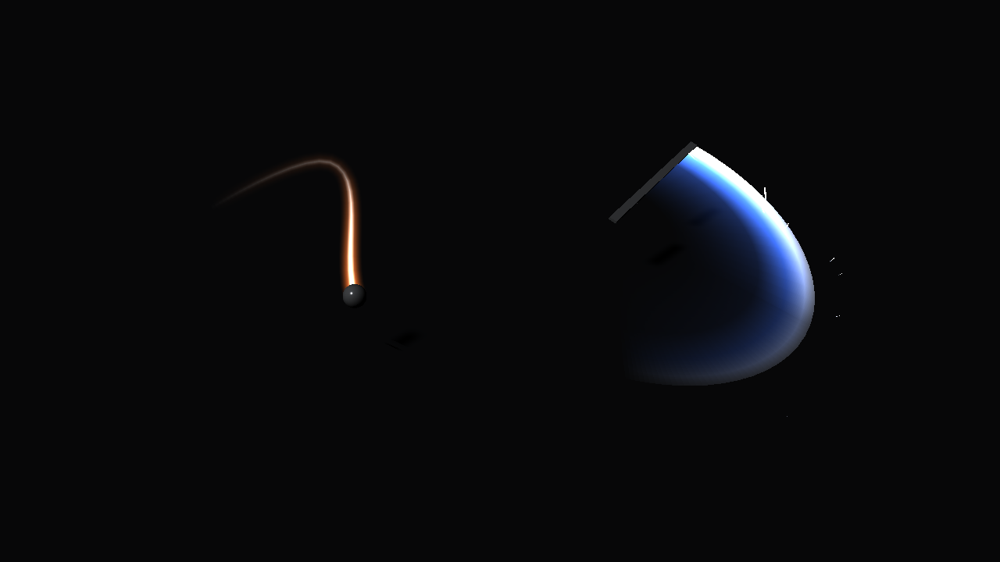

# slash-trail

Glowing motion trails for animated objects in Maya. Pick a sword, a fist or a
thrown ball, press Create, and you get a ribbon that lights up behind it and
fades out over a few frames.



## Why

When you're blocking a fight it helps to see the slash shapes early, long
before anyone does real FX. Faking that by hand means duplicating geometry per
frame or setting up particles, and you redo it every time the timing moves. I
wanted something an animator could click once and rebuild after a retime.

It samples the animation at sub-frame times without moving the timeline, so
keys, constraints and IK all work. The whole path becomes one ribbon mesh, and
a keyed ramp on the shader only shows the part right behind the object.

## Install

Clone or download the repo and drag `install_slash_trail.py` into the Maya
viewport. That writes `slash_trail.mod` into `Documents/maya/modules`, adds a
"Slash" button to the current shelf and loads the tool straight away. If you
move the folder later, drag the file in again. To uninstall, delete
`slash_trail.mod` and the shelf button.

## Using it

Click the Slash button, or run:

```python
from slash_trail import ui
ui.show()
```

If something is selected when the window opens, it gets filled in and the
settings are fitted to its motion (frame range, trail length, width). Select
two objects, hilt then tip, to start in blade mode, which sweeps between the
two instead of following a single pivot. Selecting an existing trail loads its
settings back into the window, and Rebuild Selected rebuilds it after you've
changed the animation.

From a script:

```python
from slash_trail import maya_build, settings

slash = maya_build.create(settings.TrailSettings(
    base="sword_ctl", use_blade=True, axis="y", length=90,
    start=101, end=112, trail_frames=5,
    color=(1.0, 0.35, 0.1), sparks=True,
))

maya_build.rebuild(slash)   # after changing the animation
```

## Tests

Without Maya (the UI tests need PySide6):

```
pip install -e ".[test,ui]"
pytest
```

Inside Maya, where it also builds real trails and checks the results, run
`mayapy -m pytest`.

## Limits

The trail sits in world space, so moving its group pulls it off the blade.
Rebuild instead. A camera-facing trail is built for one camera and can look
thin from a very different angle. Sparks fly straight, with no gravity or
drag. The look is set up for Arnold and Viewport 2.0 using `standardSurface`;
other renderers need their own emission and opacity hookup.

`WALKTHROUGH.md` goes through how each part works. MIT licensed.
